# KPI Deck Automation for Databricks

A Streamlit app that automates a monthly reporting cycle: raw Excel exports are routed, cleaned and
loaded into Unity Catalog tables, and a PowerPoint KPI deck is refreshed from the newest data.
Python 3.11+ · Streamlit · Databricks SQL / SDK · pandas · python-pptx · Playwright · pytest.

> **Portfolio edition.** Every organisation name, host, catalog, dashboard id and data row is
> fictional (Contoso, Northwind, Fabrikam, `.example` domains). Everything that does **not** need a
> workspace runs locally: file routing, cleaning, dry-run load plans, template tagging, deck refresh
> and the local chat answers. Anything that talks to a live workspace (archive, SQL writes, Genie,
> dashboard capture) needs your own Databricks configuration and was **not exercised** in this
> edition. Each screenshot and diagram below says which of the two it is.

## Background
I work in an analytics department where we build KPIs and dashboards on Databricks for a set of internal
programmes: a community, trainings on two learning platforms, events, a guild and a revenue view. Management
sees the results in a monthly KPI deck, so every month ends with the same job: get the latest data into
Databricks, then turn it into slides.

## The problem
The data does not arrive in one place or one shape. The Excel files come from different sources and
channels: exports downloaded from learning platforms, TEAMS member listings, registration forms,
attendance lists, and files that were simply sent around in messages and emails. Every month, by hand:

1. Collect the files from those places and work out which file belongs to which table.
2. Clean each one: remove duplicates and repeat submissions, drop short visits, fix the reporting month,
   fill missing country and company from the email address.
3. Upload it to the right Databricks table in the right way: replace, append, or a new table per period,
   without double-counting a month that was loaded before.
4. Open the dashboards, check the numbers, and build the presentation: copy the new figures into the deck,
   screenshot the widgets (geographic maps by country, participation charts, top lists, multiple widgets per
   dashboard) and paste them over last month's pictures, keeping the layout intact.

Each step was small, but together they were slow and easy to get wrong: a file tagged with the wrong month,
a chart pasted over the wrong picture, a table loaded twice.

## The idea
The same rules were applied by hand every month, so they could be written down once. I split the job in two
halves that only meet in Databricks:

* **Load**: an upload page that recognises each file, shows *what it will do* (table, write mode, month, rows
  before and after) and only then writes.
* **Deck**: a template deck whose KPI numbers and chart pictures are tagged, so a refresh replaces exactly
  those and leaves everything else untouched.

## How it was developed
1. **Ingestion first.** Ordered filename rules, write modes, cleaning and enrichment, with a dry-run plan so a
   wrong month or table is visible before anything is written.
2. **Then the deck.** KPI queries defined once, dashboard widgets captured as images (with a locally drawn
   fallback), values and pictures replaced by tag, manual slides protected, and a "what changed" summary.
3. **Then the questions.** An "Ask the data" chat on top of a Databricks Genie space, showing the SQL it ran,
   plus instant local answers about the app itself.
4. **Then reuse.** Template tagging moved from a one-off script into an in-app page driven by a JSON spec,
   so a new deck can be prepared without clicking through PowerPoint.
5. **Portfolio edition.** All real names, hosts and data were replaced with a fictional organisation and
   synthetic files, secrets moved to environment variables, SQL building hardened, and tests added.

## What happens when you upload Excel files
Real output from the app, running locally on the bundled synthetic files in `demo_data/excel/`
(**Write to Databricks** off, so this is the dry-run plan, which is exactly what would be written).

**1 · Month detection.** The month is read from the filename; files without one ask for it. The
`20260803` in an LMS export name is the *export date*, so the app says so and uses the picked period.

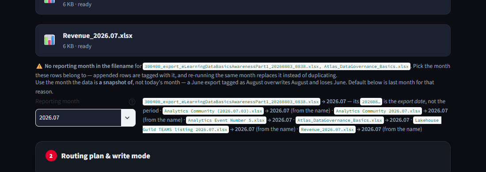

**2 · Routing plan.** Each file is matched against ordered regex rules and gets a target table, a
write mode, an archive path, rows in → out, and the cleaning it will apply. Files load in dependency
order (registrations before the listings that read their Country).

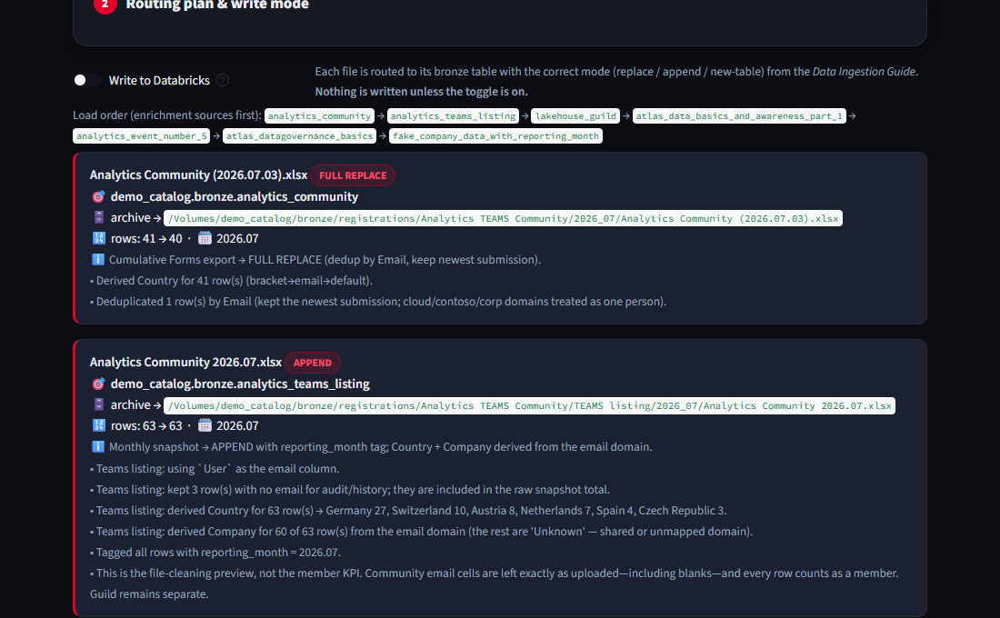

* `Analytics Community (2026.07.03).xlsx` → `FULL REPLACE`, **41 → 40 rows**: one repeat submission by
  the same person was dropped, keeping the newest.
* `Analytics Community 2026.07.xlsx` → `APPEND`, 63 rows: Country derived for all 63 and Company for
  60 from the email domain; 3 rows with no email are kept for audit and counted in the raw total.

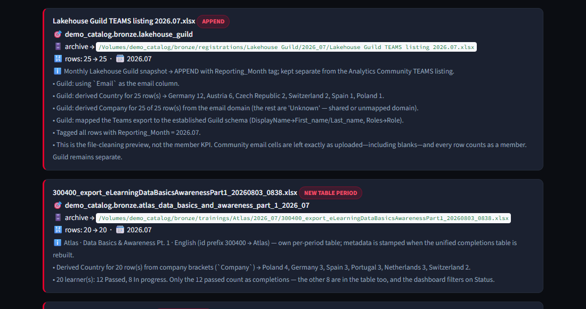

* The learning export is told apart by its id prefix (`300400_` → Atlas), gets its own per-period
  table, and the plan states that only the 12 *passed* learners count as completions.

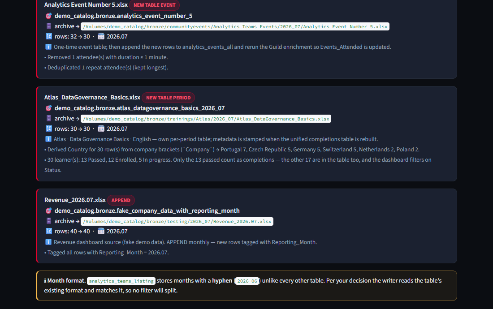

* Event attendance 32 → 30: one visit under a minute and one repeat attendee were removed.
* Re-running a month **replaces that month only** (delete-then-insert per table and month), so a
  second upload cannot double-count. The plan shows which periods the target table already holds.

**3 · Unknown files are not guessed.** If no rule matches, the plan says `NO MATCH`, nothing is
written, and the app inspects the *contents*: when the columns resemble a known table it offers a
ranked choice with a confidence score; otherwise it asks for a rename.

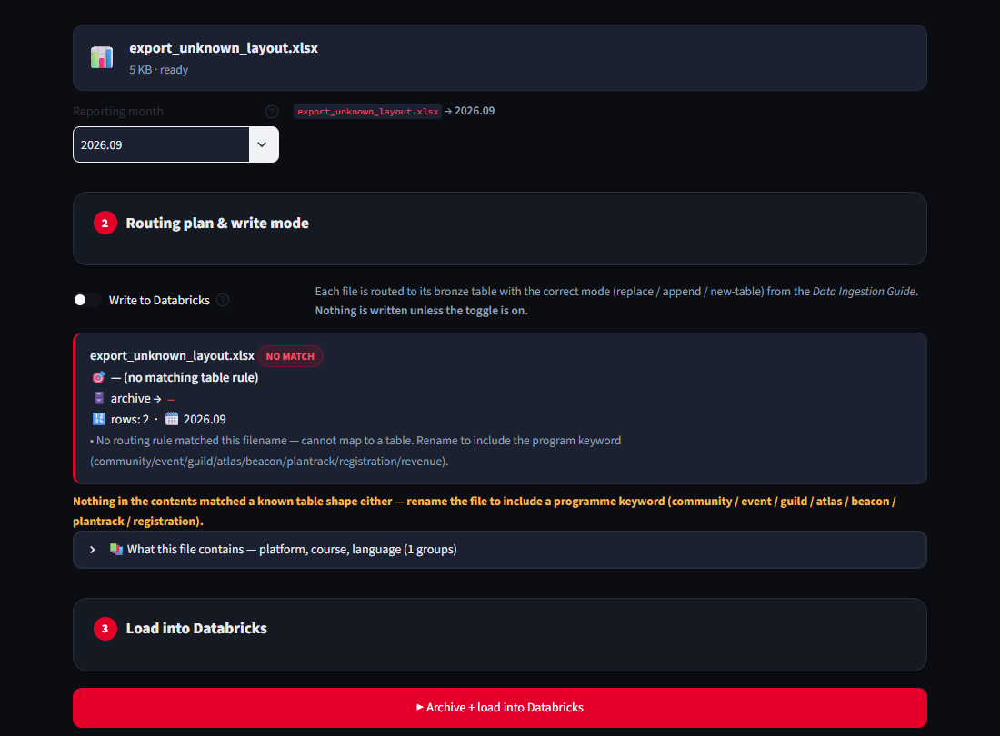

**4 · Execute** (only with the toggle on, needs a workspace). Archive the raw file to the Volume,
replace the month, insert (batched `VALUES` up to 300 rows, staged Parquet + `read_files()` above),
record the run, refresh dependent tables. The diagram shows each step and the function behind it.

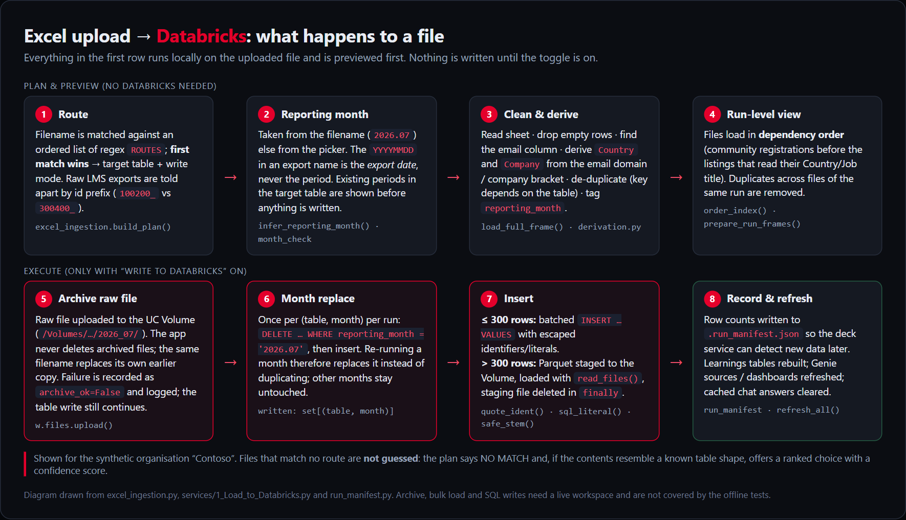
<sub>Diagram drawn from the code, not a live run.</sub>

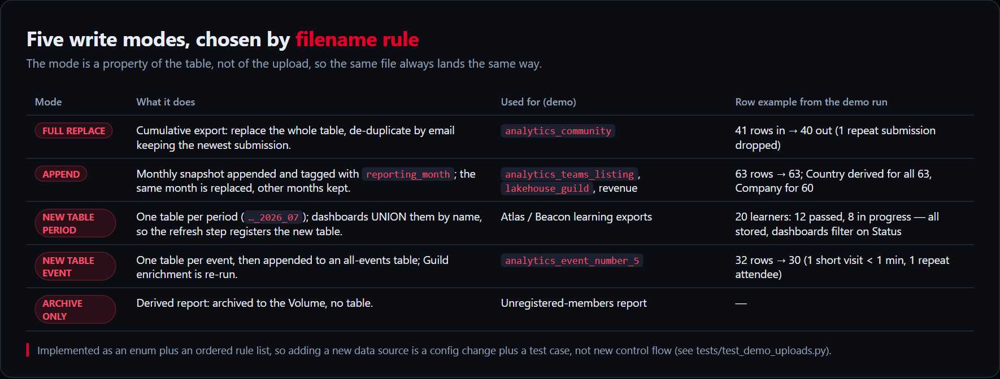

## Refreshing the deck
The PowerPoint is a *template*. Only shapes named `kpi:<key>` (text) or `chart:<key>` (picture) are
touched; every other shape, and every slide marked manual, is left exactly as designed. KPI values
and chart data come from SQL defined once in `kpis.py`; dashboard tiles are screenshotted headlessly
and, if a tile can't be found, the chart is rendered locally from the same data so the deck is never
incomplete. Month labels roll forward together (`2026.06 → 2026.07`, `June 2026 → July 2026`).

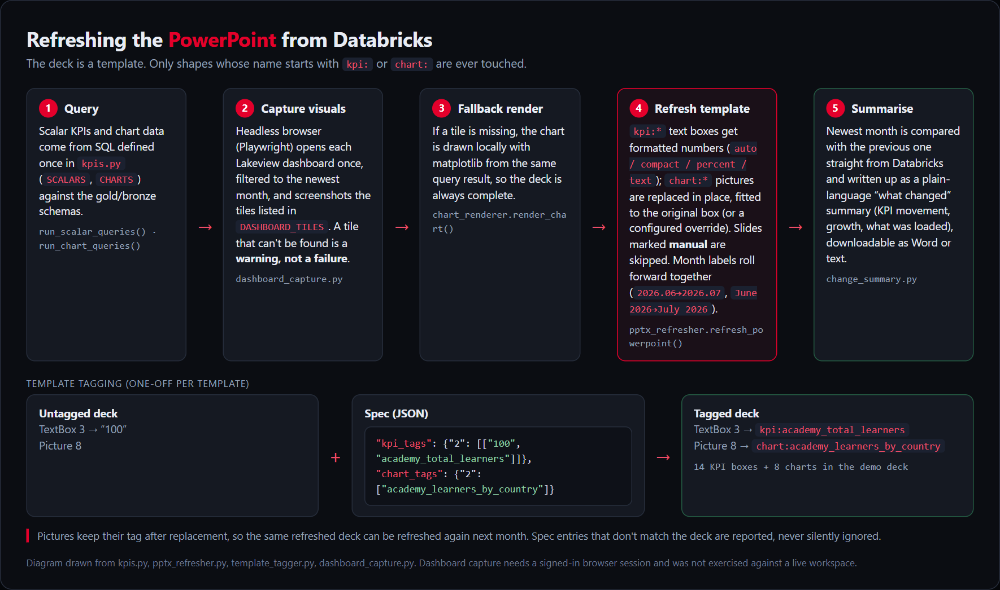
<sub>Diagram drawn from the code. The refresher and tagger are covered by offline tests; query and
dashboard capture need a workspace.</sub>

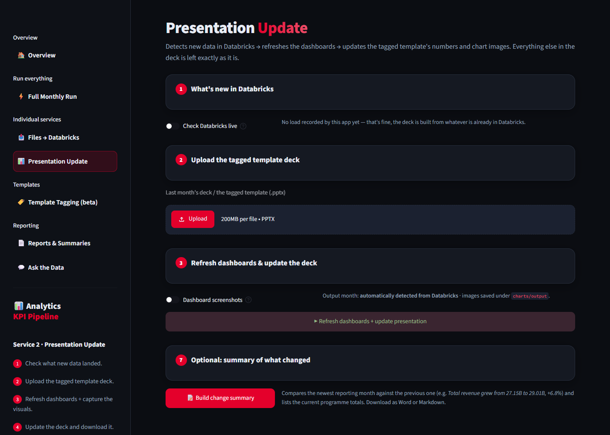

### Template tagging (beta)
Tagging is repeatable instead of clicking through PowerPoint: upload an untagged deck, see every text
box and picture per slide, adjust a JSON spec (`[visible text, key]` pairs and picture keys), and
download the tagged template. Spec entries that match nothing are reported, never silently dropped.
Real run on the demo deck: **14 KPI boxes and 8 charts tagged**, identical to the shipped template
(asserted in `tests/test_deck_refresh.py`).

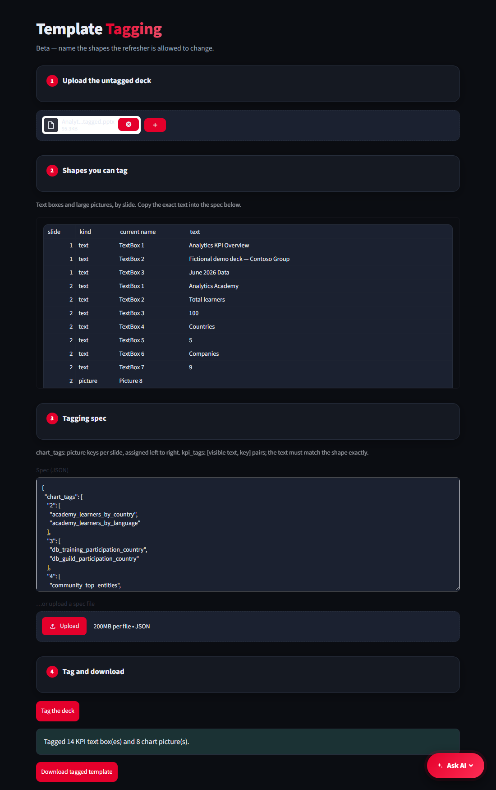

## "Ask the data" chat
There is no separate LLM. Data questions go to a **Databricks Genie space** over the same governed
tables, which writes and runs SQL; every answer includes an expander with the SQL so a figure can be
verified. Questions about the *app itself* ("what tables are there?", "is my data safe?") are answered
locally from a knowledge base, instantly and offline, so the app cannot invent behaviour it does not
have. A data-shaped question vetoes the local answer, repeat questions are cached (cleared after each
load), and one failed Genie call is retried once before an error is shown.

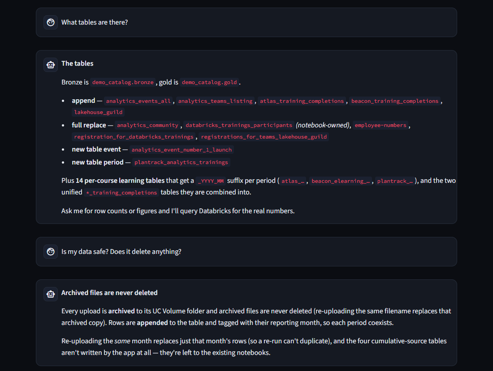
<sub>Real screenshot of the local-answer path. Genie answers need a workspace and were not captured.</sub>

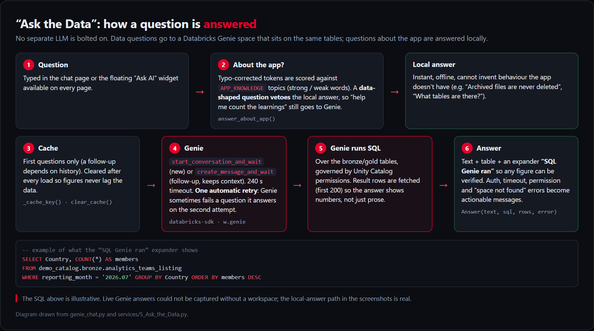
<sub>Diagram drawn from `genie_chat.py`. The SQL shown is illustrative.</sub>

## Run it
```bash
python -m venv .venv
.venv/Scripts/activate        # Windows; use source .venv/bin/activate elsewhere
pip install -r requirements-dev.txt
cp .env.example .env          # optional: only needed to connect to a real workspace
python -m pytest tests        # 73 tests, no network
streamlit run app.py
```
Python 3.11+ is required (`tomllib`). Without Databricks you can:
* **Files → Databricks**: upload files from `demo_data/excel/` with *Write to Databricks* **off**.
* **Template Tagging (beta)**: upload `demo_data/Analytics_KPIs_demo_untagged.pptx`, keep the prefilled
  spec, click *Tag the deck*.
* **Ask the Data**: try "What tables are there?" or "Is my data safe?".

**Presentation Update** and **Full Monthly Run** always read KPI values from Databricks, so they need a
configured workspace. Regenerate the demo assets with `python demo_data/build_demo_assets.py`.

## Configuration
* `.env` / environment variables (`settings.py`, see `.env.example`): workspace, catalog, schemas,
  dashboard ids, Genie space. Authentication uses `databricks auth login`; no token is stored.
* `config/org_profile.toml`: the fictional organisation (domains → countries/companies, aliases).
  Point `ORG_PROFILE_PATH` at your own file.
* `config/deck_layout.json`: manual slides and chart box overrides for the deck.

## Engineering notes
* **Safety by default.** Nothing is written without an explicit toggle; the plan is shown first.
  Identifiers and literals in generated SQL are escaped (`quote_ident`, `sql_literal`), staging file
  names are sanitised (`safe_stem`), and temporary Volume files are removed in a `finally`.
* **Archived raw files are never deleted by the app**, but uploading the same filename replaces its
  own archived copy. Archive failures are recorded (`archive_ok`) and shown rather than hidden.
* **Config over code.** Routing rules, the organisation profile and the deck layout are data; adding
  a source is a rule plus a test case (`tests/test_demo_uploads.py` covers every demo file).
* **Tests** (73, offline): routing and write modes, cleaning rules, SQL escaping, template tagging,
  deck refresh including manual-slide protection and chart box overrides.

## Limitations
Archive, bulk load, SQL writes, Genie answers and dashboard capture were not run against a live
workspace in this edition. Cards on the overview page can differ by a few pixels at narrow widths.
The feature audit and the list of fixes made during the cleanup are in
[docs/PROJECT_AUDIT.md](docs/PROJECT_AUDIT.md); module map in [docs/ARCHITECTURE.md](docs/ARCHITECTURE.md).

### Other screens
[Overview](docs/screenshots/01_overview.png) · [Full Monthly Run](docs/screenshots/04_full_run.png) ·
[Reports & Summaries](docs/screenshots/07_reports.png). Diagram sources: `docs/diagrams/diagrams.html`.
